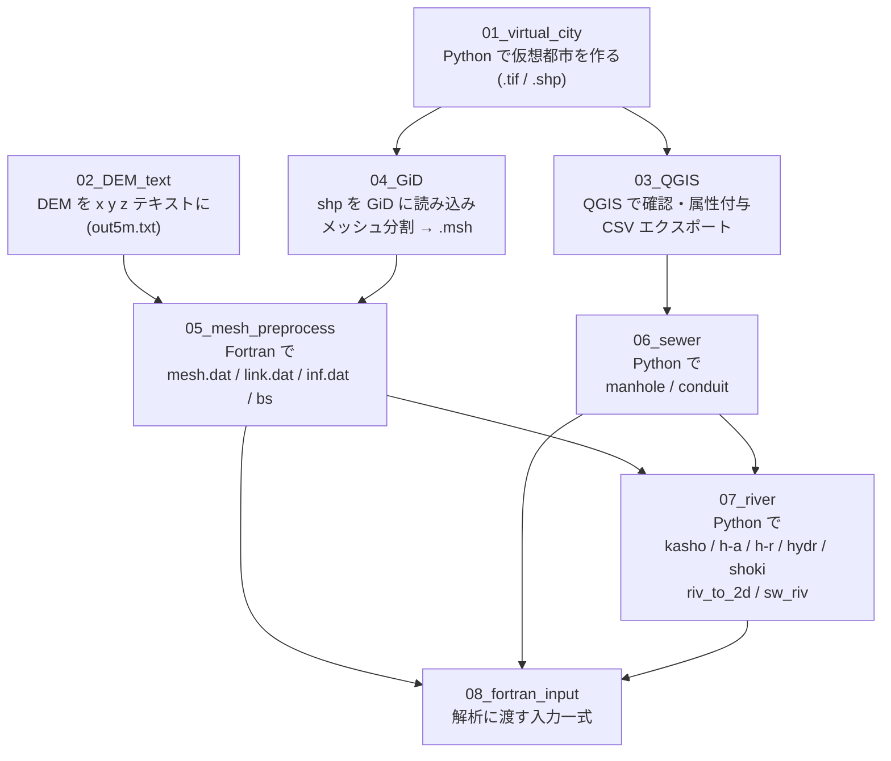

# 仮想都市 氾濫解析 入力データ作成チュートリアル

仮想都市（道路・建物・河川・下水道）を Python で作り、GIS → GiD でメッシュ化し、
Fortran 氾濫解析モデル（2次元氾濫 + 下水道 + 1次元河川）の **入力ファイル一式** を作るまでの手順をまとめたリポジトリです。

> はじめての人は、この README を読んだあと **01 → 08 の順番** に各フォルダの `README.md` を読んでください。
> 各フォルダには、実際に使ったスクリプトと、その **出力例（city4）** が入っています。

---

## 1. 全体の流れ



| 段階 | フォルダ | 使うもの | 主な入力 | 主な出力 |
|---|---|---|---|---|
| 1 | `01_virtual_city/` | Python | （パラメータのみ） | DEM `.tif`、道路・建物・河川・下水道の `.shp` |
| 2 | `02_DEM_text/` | Python | （パラメータのみ） | `out5m.txt`（x y z 形式の 5 m DEM） |
| 3 | `03_QGIS/` | QGIS | 01 の `.shp` | 下水道 `Nodes.csv` / `Branches_with_diameter.csv` |
| 4 | `04_GiD/` | GiD | 01 の `.shp` | `city4_after_all.msh` ほか属性別 `.msh` |
| 5 | `05_mesh_preprocess/` | Fortran | 04 の `.msh`、02 の `out5m.txt` | `mesh.dat` `link.dat` `node.dat` `inf.dat` `bs_op_corrected.dat` |
| 6 | `06_sewer/` | Python | 03 の CSV | `manhole_bshosei.dat` `conduit_bshosei.dat` |
| 7 | `07_river/` | Python | 05・06 の出力 | `kasho` `h-a` `h-r` `hydr` `shoki` `riv_to_2d` `sw_riv` |
| 8 | `08_fortran_input/` | – | 05〜07 の出力 | 解析モデルに渡す入力一式 |

---

## 2. フォルダ構成

```
tutorial_github/
├── README.md                ← いま読んでいるファイル
├── requirements.txt         ← Python ライブラリ一覧
├── .gitignore
├── 01_virtual_city/         ← 仮想都市の生成（city4 = 合流河川版 / city012 = 単一河川版）
├── 02_DEM_text/             ← DEM の x y z テキスト化
├── 03_QGIS/                 ← QGIS での作業と補助スクリプト
├── 04_GiD/                  ← GiD でのメッシュ作成
├── 05_mesh_preprocess/      ← Fortran: メッシュ属性・接続関係・地盤高
├── 06_sewer/                ← 下水道（マンホール・管渠）データ
├── 07_river/                ← 河川（1次元）データと氾濫原・下水道との接続
├── 08_fortran_input/        ← 最終的な入力ファイル一式（city4 例）
├── docs/                    ← 環境構築・ファイル書式・GitHub 操作の説明
│   ├── environment.md
│   ├── fortran_input_read_code.md
│   ├── fortran_output_write_code.md
│   ├── github_push.md
│   └── reference/           ← 研究室資料（pptx/pdf, Git 管理外）
└── archive/                 ← 試行錯誤の旧バージョン（参考用。通常は見なくてよい）
```

### city4 と city012
- **city4**（`city_confluence`）: 本川 + 支川の **合流** がある都市。本チュートリアルの **標準例**。
- **city012**（city0 / city1 / city2）: 1 本の河川が南北に流れる都市。
- 都市の形が違うだけで **作業の流れは同じ** です。city012 の旧データは `archive/` に置いています。

---

## 3. クイックスタート（city4 を再現する）

1. 環境を用意する → [`docs/environment.md`](docs/environment.md)
2. 仮想都市を作る
   ```bash
   cd 01_virtual_city/city4
   python makecity_3.py
   ```
3. DEM テキストを作る
   ```bash
   cd 02_DEM_text
   python make_DEM_city0.py     # 平坦 (z=0) の DEM。city4 はこれを使用
   ```
4. QGIS で `.shp` を確認し、下水道ノード・管路を CSV で書き出す → [`03_QGIS/README.md`](03_QGIS/README.md)
5. GiD で `.shp` を読み込み、メッシュを切って `.msh` を出力 → [`04_GiD/README.md`](04_GiD/README.md)
6. Fortran でメッシュデータを作る
   ```bash
   cd 05_mesh_preprocess/city4
   cp ../../02_DEM_text/DEM_text/city0/out5m2.txt ./out5m.txt   # または example_output/out5m.txt
   bash run_mesh.sh
   ```
7. 下水道データを作る → [`06_sewer/README.md`](06_sewer/README.md)
8. 河川データを作る → [`07_river/README.md`](07_river/README.md)
9. `08_fortran_input/` に集めて解析へ → [`08_fortran_input/README.md`](08_fortran_input/README.md)

---

## 4. 座標系と共通パラメータ（city4）

| 項目 | 値 |
|---|---|
| 座標系 | JGD2011 / 平面直角座標系 第 IX 系（**EPSG:6677**） |
| 計算領域 | 3000 m × 3000 m（x: 152000–155000, y: 502000–505000） |
| DEM 解像度 | 5 m（600 × 600 セル） |
| 都市範囲 | 領域の外周 500 m を除いた内側 |
| 道路 | 幅 40 m、間隔 200 m の格子 |
| 河川 | 本川 幅 30 m、支川 幅 15–20 m（合流あり） |

---

## 5. ファイル名のルール（このリポジトリで統一したこと）

- 各段階の作業フォルダには **スクリプト・入力・出力をまとめて** 置いています（スクリプトはカレントディレクトリのファイルを読み書きするため）。
- 元のフォルダで `_v2`, `_re`, `0125` などが付いて乱立していたファイルは、**最終的に使ったもの（city4 の最新版）だけ** を残し、残りは `archive/` に移しました。
- `08_fortran_input/` では、Fortran 側が読む名前（`kasho.dat`, `h-a.dat` …）に **リネーム済み** です。

## 6. GitHub への push

[`docs/github_push.md`](docs/github_push.md) を参照してください。

## 7. 未確認・注意事項

整理の途中で、元のファイルからは判断できなかった点は各 README に **「⚠ 要確認」** として書いています。気づいた人は追記してください。
